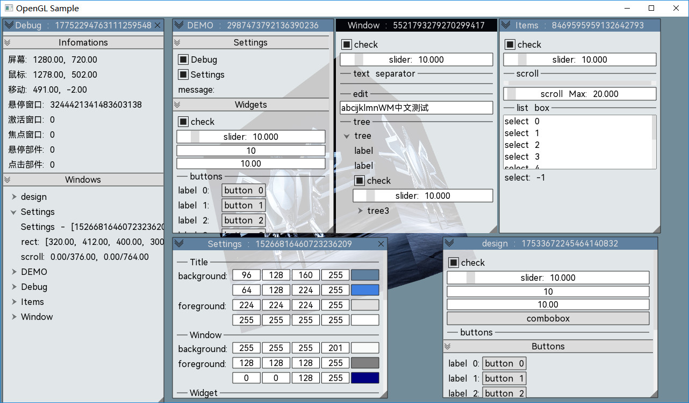
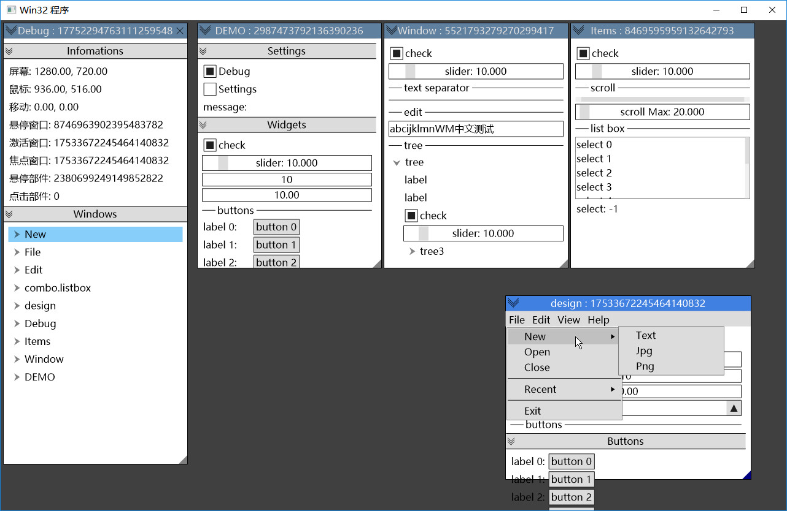

# minimgui

**minimgui** 是一个立即模式的UI库，原生支持2D API，比如 Gdiplus，更方便向其他 2D API 移植，同时也支持 3D API。更小巧，结构更紧凑。

# 效果截图

# 日志
- 2026-10-31 19:14:42 菜单功能完善，图片功能实现
- 2026-10-30 00:02:17 版本更新
写了大概半个月了，实现了多窗体界面，组件实现的有：**折叠面板**、**标签**、**按钮**、**选择框**、**编辑框**、**可选择按钮**、**分隔符**、**滑块**、**滚动条**、**列表框**、**树节点**、**拖拽数字**。**菜单栏**、**弹出菜单**实现的有些不太满意，主要是即时生成的部件，不好处理布局。
- 2026-03-16 22:31:30 启动项目